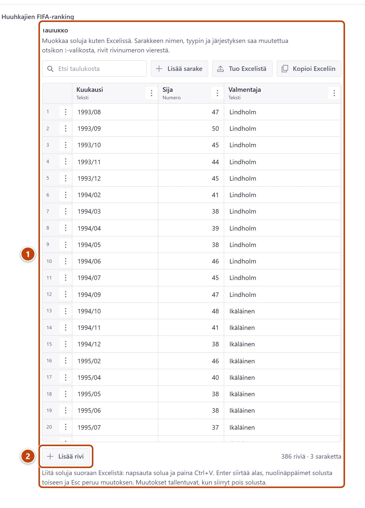

## Milloin

Kun FIFA julkaisee uuden maailmanlistan, yleensä kerran kuussa. Lisäät yhden rivin, ja sivu
**Jalkapalloarkisto → FIFA-ranking** piirtää kuvaajan, nykyisen sijan, parhaan ja heikoimman sijan,
keskiarvon ja valmentajien kaudet itse. Kuvaa ei enää tehdä Excelissä.

## Askeleet

1. Vasemmasta valikosta valitse **Jalkapalloarkisto**, sitten **Tilastot** ja **Muut arkiston taulukot**.
2. Valitse listasta taulukko Huuhkajien FIFA-ranking.
3. Valitse otsikon alta välilehti **Tilastodata**.
4. Taulukko näyttää kerralla noin 20 riviä. Vieritä taulukkoa sen omassa laatikossa loppuun asti:
   viimeisellä rivillä on edellinen lista. ①
5. Paina taulukon alla **Lisää rivi**. ②
   Uusi tyhjä rivi tulee taulukon loppuun.
6. Kirjoita uudelle riville:
   - Kuukausi: vuosi, kauttaviiva ja kuukausi kahdella numerolla, esimerkiksi 2026/11
   - Sija: pelkkä numero, esimerkiksi 74
   - Valmentaja: päävalmentajan sukunimi samoin kuin edellisellä rivillä, esimerkiksi Friis.
7. Paina oikeassa alakulmassa **Julkaise**.

> [!TIP]
> Kun päävalmentaja vaihtuu, kirjoita uuden valmentajan nimi jo ensimmäiselle uudelle riville.
> Jos sama valmentaja palaa myöhemmin, erota kaudet numerolla kuten taulukossa on tehty
> (Kanerva 1, Kanerva 2, Kanerva 3).

## Tulos

- Alapalkissa lukee "Viimeksi julkaistu juuri nyt".
- Noin minuutin kuluttua sivun kuvaaja jatkuu uuteen kuukauteen, ja kortti "Sija nyt" näyttää
  uuden sijan ja muutoksen edelliseen listaan.

## Lisävalinnat

- FIFA julkaisi kuukaudessa kaksi listaa: kirjoita vain kuukauden viimeinen. Kuukausi saa olla
  taulukossa vain kerran.
- FIFA ei julkaissut listaa jonain kuukautena: jätä kuukausi pois. Kuvaaja yhdistää viereiset kuukaudet.
- Koko taulukko kerralla Excelistä: paina **Tuo Excelistä**, liitä solut otsikkoriveineen ja valitse
  **Korvaa koko taulukko (sarakkeet ja rivit)**. Sarakkeet ovat Kuukausi (tai Aika), Sija ja Valmentaja.
- Uutinen rankingista: kirjoita se kenttään **Johdanto** välilehdellä **Perustiedot**. Uutiset näkyvät
  kuvaajan alla. Lukuja ei tarvitse kirjoittaa tekstiin, sillä sivu laskee ne itse.
- Muu taulukon muokkaus: [Päivitä tilastotaulukko](tilastotaulukon-paivitys.md)

## Jos jokin menee vikaan

- **Julkaise** ei toimi, ja taulukon yläpuolella on punainen ilmoitus, esimerkiksi
  "Rivi 387: kuukausi … on väärässä muodossa": korjaa ilmoituksen rivi ja julkaise uudelleen.
  Ilmoitus kertoo myös oikean muodon.
- "Kuukausi … on jo rivillä …": sama kuukausi on kahdesti. Poista toinen rivin valikosta ⋮ **Poista rivi**.
- Kuvaaja ei näy sivulla: tarkista välilehdeltä **Tilastodata**, että kohdassa
  **Kuvaaja taulukon yläpuolella** on valittuna **Sijoitushistoria (esim. FIFA-ranking)**.

Katso myös: [Päivitä tilastotaulukko](tilastotaulukon-paivitys.md) · [Luonnos, julkaisu ja peruminen](../alkuun/luonnos-julkaisu-ja-peruminen.md)
